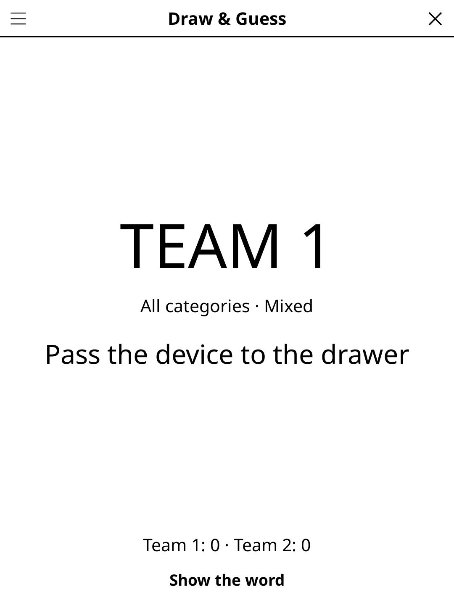

# pictionary.koplugin

A **Draw & Guess** (FR « Dessine et devine ») display plugin for [KOReader](https://github.com/koreader/koreader) — put your e-reader in the middle of the table and play draw-and-guess with pen and paper.

## Screenshot



## Concept

Teams take turns. The drawer receives the device, sees the word in secret, then draws it on paper while teammates guess. A countdown timer runs. One tap records the result, scores update automatically, and play passes to the next team.

No typing during the game — just the drawer and the device, everyone else watches the paper.

## Rules

- Teams take turns. The drawer sees the word in secret and draws it on paper; no speaking, no gestures.
- Teammates guess while the timer runs.
- **✓ Got it!** — tap to award +1 to the drawing team.
- **✗ Missed** — 0 points; play passes to the next team.
- First team to reach the agreed score wins.

## Features

- **Secret word reveal** — teammates look away while the drawer taps *Show the word*
- **Countdown timer** — 45 s, 1 min, 1:30 or 2 min (configurable)
- **Auto-scored** — ✓ Got it / ✗ Missed advances the team tracker automatically
- **Built-in word bank** — 2,880 words per language (FR + EN): 24 categories × 3 difficulties × 40 words
- **No repeats** — a word only comes back once every word of the chosen category and difficulty has been drawn, across games too
- **Category & difficulty filters** — Animals, Food, Sport, Objects… Easy / Medium / Hard / Mixed
- **2–6 teams** — configurable team count
- **E-ink friendly** — only the timer digit refreshes in fast/A2 mode

## Categories

| FR | EN |
|----|----|
| Animaux | Animals |
| Métiers | Jobs |
| Sports | Sports |
| Nourriture | Food |
| Lieux | Places |
| Objets | Objects |
| Nature | Nature |
| Activités | Activities |
| Transports | Transport |
| Corps humain | Human body |
| Vêtements | Clothing |
| Musique | Music |
| Technologie | Technology |
| Espace | Space |
| Fantastique | Fantasy |
| Cinéma et TV | Movies and TV |
| Fêtes et célébrations | Celebrations |
| École | School |
| Maison | House |
| Jouets | Toys |
| Océan | Ocean |
| Météo | Weather |
| Outils | Tools |
| Oiseaux | Birds |

## Controls

| Button | Action |
|--------|--------|
| **Voir le mot / Show the word** | Reveal the word to the drawer + start timer |
| **✓ Trouvé ! / ✓ Got it!** | Team guessed — +1 point, next team |
| **✗ Raté / ✗ Missed** | Not guessed — 0 points, next team |
| **Menu** | New game (resets the scores), Difficulty, Language (word list), Teams, Timer, Category, Rules |
| **Rules** | Show rules reminder |
| **Close** | Exit |

## Installation

### Via KOReader Plugin Manager

```
pictionary.koplugin/ → KOReader plugins/ folder
game-common/          → alongside plugins/ (shared library)
```

### Manual

1. Download `pictionary.zip` from [Releases](../../releases).
2. Extract to your KOReader `plugins/` directory.
3. Restart KOReader — **Draw & Guess** appears under Tools → Games → Party & quiz.

## Development

`pictionary.koplugin/` lives inside the
[koreader-plugins](https://github.com/t2ym5u/koreader-plugins) monorepo.
The word bank (`words.lua`) is self-contained — no external dependencies beyond `game-common`.

## License

GPL-3.0
